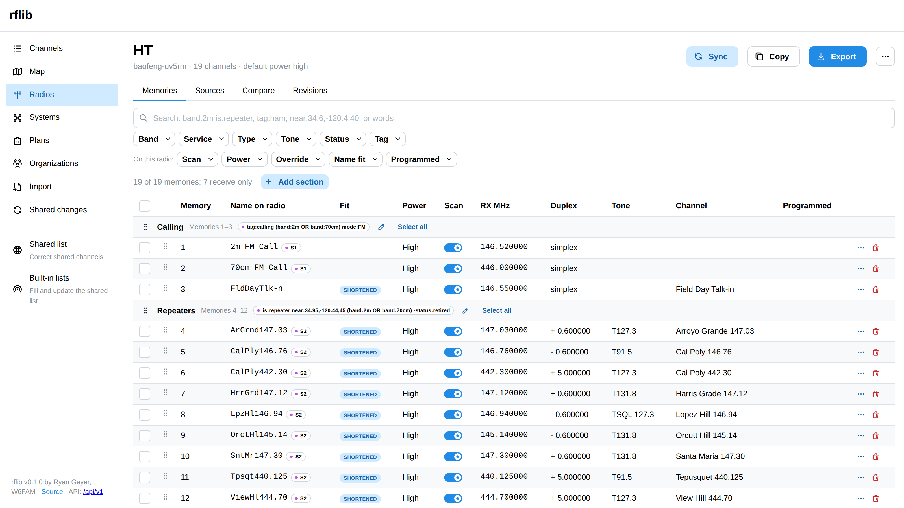
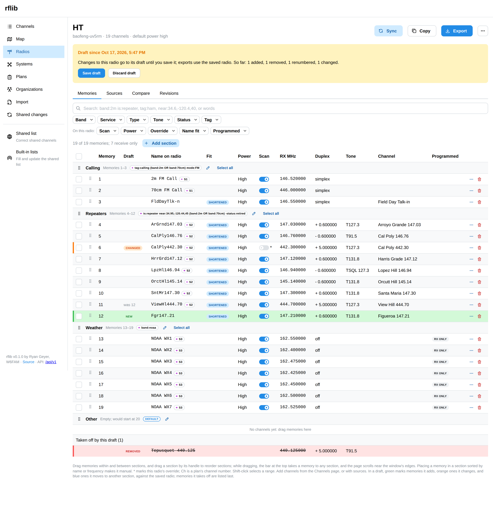
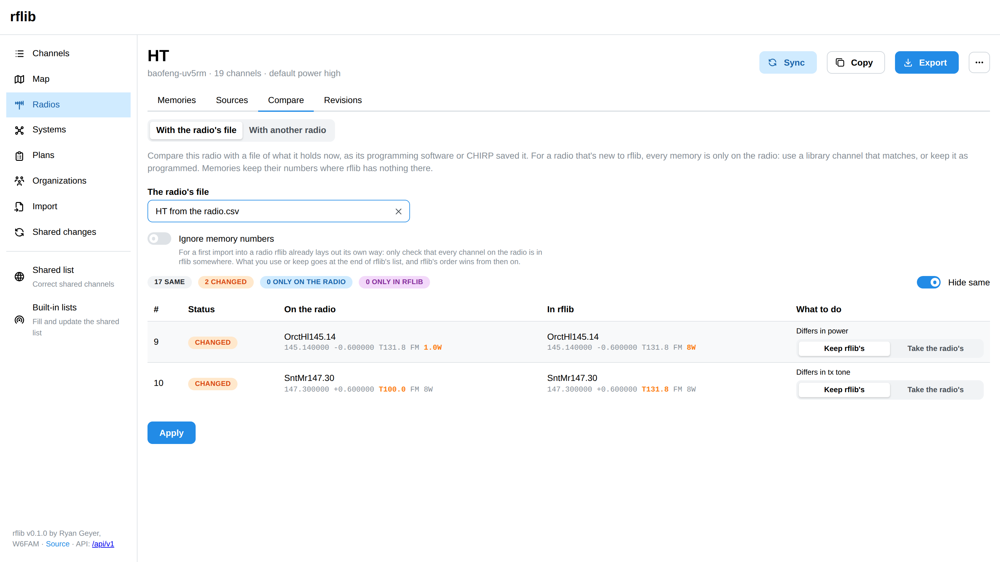
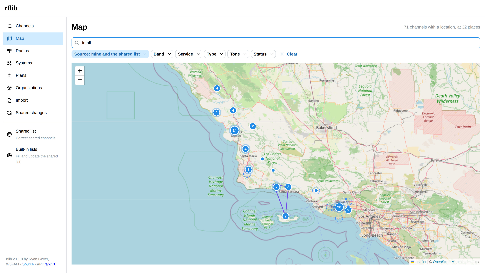

# Web interface

`rflib serve` also serves a web interface at `http://127.0.0.1:8080/`, built into the binary:

- **Channels:** search with the query language (the Band, Service, Type, Tone, Status, and Tag buttons write their terms into the search for you), add and edit channels (with a tone picker), select several to tag, set their service, retire, relink retired ones to their replacements, or add to a radio, open one to set its status (active, off the air, or retired with a replacement, yours or shared), show retired channels, which the list hides, and choose Source (in use, by default) to search the whole shared list as well as the channels you use; when the shared list has more matches, a link next to the count searches there too. **Clear** starts the search and its filters over. A globe marks a shared channel, and a note icon your notes or tags on one.
- **Shared list:** for the maintainer (an admin, on a server with accounts), opened from its own item in the navigation. Open a channel to correct it (its frequencies, tones, location, curated tags, notes, organizations, and nodes) or to set its status (off the air with a note and an expected-back date, retired with its replacement, or active). Each correction asks for a reason and reaches everyone who uses the channel. Corrections are made one channel at a time.
- **Map:** channels with a location, and how far each reaches, narrowed with the same search and filters as the Channels page. Like a search there, it starts with the channels in use, and offers the shared list's other located channels; **Source** chooses. Channels at one place share a marker numbered with how many there are, whose popup lists them all, and markers too close to tell apart join a numbered cluster that opens as you zoom in or click it. The map background comes from OpenStreetMap, so it needs an internet connection; everything else works without one.
- **Radios:** the list marks a radio with an open draft, one that needs programming, and one a sync would change. A radio's **Revisions** tab lists its revisions, saves one, compares one with now, and restores one into the draft (see [Revisions and programming](radio-history.md#revisions-and-programming)). Each radio's changes go to its draft, with **Save draft** and **Discard draft** (see [Drafts](radios.md#drafts)); each radio's memories as they'll be programmed, with warnings, scan switches, and moves. Search them as you would channels, filter by this radio's own settings (scan, power, overrides, how the name fit, and how it's programmed), and see in the Programmed column, and the count above the list, which memories aren't programmed (struck through, with no number, as on the programmed radio), which are receive-only, and which carry only their transmit tone, and select several (shift-click selects a range) to set scan or power, or take them off the radio; memories are grouped by section, with each section's memory range and sources, and you drag memories within and between sections (while dragging, a bar at the top of the window takes a memory to any section, and the page scrolls near the window's edges), and drag sections by their handles to reorder them (a menu on each memory moves it too); **Add section** and each section's edit button set its name, start, size or end, order, and whether it's the default, or merge it into another (or drag a section onto the **Merge into** bar that appears while dragging it); selected memories move to a section with **Move to section**; its sources, with a preview of what a new source would add before you add it; sync with a preview; the programming file to download; **Copy**, which makes a new radio from this one for another model; the **⋯** menu, to edit the radio's settings (name, default power, duplicate names, name length, and notes) or delete it, which needs its name typed and leaves its channels in the library; and **Compare**: with another radio, by channel, adding what the other has; or with the radio's file, which reads the radio's current file and lets you choose, memory by memory, a matching channel, keeping it as programmed, or taking the radio's changes; **Ignore memory numbers** makes it a first import that only checks everything on the radio is in rflib. On the Channels page, **Add search as source** puts the current search on a radio as a source, with the same preview.
- **Systems, Plans, and Organizations:** the shared list's systems with a map of their links, plans laid out as ICS 205 with their entries, and organizations with what they run. The maintainer edits them; each change asks for a reason and shows in the page's history. A radio's Sources tab adds a plan as a source.
- **Import:** a file, its options, a dry-run preview, then the import.
- **Built-in lists** (under the Shared list, for the maintainer) and **shared changes**, as `rflib seed update` and `rflib shared changes` do. Each list shows whether the shared list is up to date with it; reviewing an update lists the channels to add, update, and retire, and any correction it keeps.

When the server needs a token (`$RFLIB_API_TOKEN`), the page asks for it once and keeps it in the browser. On a server with accounts, the page asks you to sign in or make an account instead (see [Accounts](accounts.md)), and the menu at the top right changes your display name, email, and password, or signs you out.

Building the interface needs Node.js: `make web` builds it into `web/dist`, and `make build` then embeds it. An rflib built without it serves a page saying so. See [Development](development.md).

## Screenshots

From rflib's demo (`web/demo` makes them): a handheld and a truck radio built from a shared list of Central Coast California repeaters.

**A radio's memories**, in sections, as they'll be programmed: each section from a search, with names fitted to the radio's display.

**A draft**, marked against the saved radio: a repeater added (green), one with scanning turned off (orange), one renumbered, and one taken off, listed last.

**Comparing with the radio's file**: what was changed on the radio itself, here a tone and a power level, with the choice of keeping rflib's or taking the radio's.

**The map**: the shared list's repeaters, clustered where they're close, with the links of the systems they belong to.

---

[Documentation index](README.md)
